# clickspec

CLI tool that records browser interactions and generates maintainable Playwright E2E tests with automatic assertions.

[](https://github.com/fiizam/clickspec/actions)
[](LICENSE)
[](https://nodejs.org/)
[](https://www.typescriptlang.org/)
[](https://playwright.dev/)

---

## Why not just use `playwright codegen`?

Playwright includes a built-in recorder, but the scripts it outputs usually require manual refactoring before they can be committed to a production test suite:

- **Fragile selectors:** Defaults to deep DOM paths (`div > div:nth-child(2) > button`) or arbitrary CSS classes that break on the next styling change.
- **Zero assertions:** It records what you clicked, but never verifies whether the page actually responded correctly.
- **Event noise:** Rapid keystrokes and double-clicks produce cluttered, non-atomic test code.

`clickspec` intercepts both user events and the resulting DOM mutations, normalizes the event stream, and uses an LLM to generate tests that follow current testing best practices:

- Uses accessibility-first locators (`getByRole`, `getByLabel`, `getByTestId`).
- Watches for DOM changes (toasts, modals, URL transitions, alert banners) and generates meaningful `expect(...)` assertions.
- Debounces keystrokes into clean `fill()` actions.

---

## Generated Test Example

Here is a typical test generated after recording a login interaction:

```typescript
import { test, expect } from '@playwright/test';

test('User authentication flow', async ({ page }) => {
  await page.goto('https://app.example.com/login');

  await page.getByLabel('Email address').fill('user@example.com');
  await page.getByLabel('Password').fill('secret123');
  await page.getByRole('button', { name: 'Sign in' }).click();

  // Inferred automatically from post-click DOM mutation & URL transition
  await expect(page).toHaveURL(/.*dashboard/);
  await expect(page.getByRole('alert')).toContainText('Login successful');
  await expect(page.getByRole('heading', { name: 'Welcome back' })).toBeVisible();
});
```

---

## Getting Started

### Prerequisites

- Node.js 18 or newer
- An API key for **Google Gemini** (recommended, free tier available at [Google AI Studio](https://aistudio.google.com/)) or **OpenAI**.

### Installation

```bash
git clone https://github.com/fiizam/clickspec.git
cd clickspec
npm install
npm run build
```

### Configuration

Copy the example environment file:

```bash
cp .env.example .env
```

Add your API key to `.env`:

```env
# Gemini API Key (Default)
GEMINI_API_KEY=your_gemini_api_key_here

# Optional: Override model (defaults to gemini-3.8-flash)
# CLICK_SPEC_MODEL=gemini-3.8-flash

# Optional: Use OpenAI or compatible providers (Groq, DeepSeek, Ollama)
# OPENAI_API_KEY=your_openai_key
# OPENAI_BASE_URL=https://api.groq.com/openai/v1
```

---

## Usage

### Interactive Mode

Run the CLI with a target URL:

```bash
npm run dev -- https://example.com
```

1. Confirm or adjust the output file path (default: `./tests/flow.spec.ts`).
2. A Chromium window opens at the target URL.
3. Interact with the page (click buttons, fill out forms, navigate links).
4. When finished, close the browser window or press `Enter` in the terminal.
5. The generated test script is formatted and saved to disk.

### CLI Options

```bash
clickspec [url] [options]
```

| Option | Shorthand | Description | Default |
|--------|-----------|-------------|---------|
| `url` | - | Target URL to record | Prompts if omitted |
| `--output <path>` | `-o` | Destination path for the generated spec | `./tests/flow.spec.ts` |
| `--model <name>` | `-m` | AI model override | `gemini-3.8-flash` |
| `--title <title>` | - | Explicit test case title | Inferred from journey |
| `--headless` | - | Run browser without UI (useful for CI scripts) | `false` |
| `--debug` | - | Output detailed event logs to terminal | `false` |
| `--help` | `-h` | Display help screen | - |

#### Examples

```bash
# Record against a local dev server
npm run dev -- http://localhost:3000 -o ./tests/checkout.spec.ts

# Set a custom test title
npm run dev -- https://my-app.com --title "User Registration Journey"
```

---

## Running Generated Tests

Execute the generated test file using the Playwright test runner:

```bash
# Run headed to visually observe execution
npx playwright test tests/flow.spec.ts --headed

# Open the HTML test report
npx playwright show-report
```

---

## How It Works

```mermaid
flowchart LR
    subgraph S1 ["1. Browser Capture"]
        direction TB
        A["Chromium Instance"] --> B["In-Page Observer"]
        B --> C["DOM Mutation Watcher"]
    end

    subgraph S2 ["2. Normalizer"]
        direction TB
        D["Event Normalizer"] --> E["Prompt Compiler"]
    end

    subgraph S3 ["3. AI Synthesis"]
        direction TB
        F["Gemini 3.8 Flash"] --> G["Spec Formatter"]
    end

    subgraph S4 ["4. Output"]
        direction TB
        H["tests/flow.spec.ts"]
    end

    C -->|"Raw Events"| D
    E -->|"Context Payload"| F
    G -->|"Validated Spec"| H

    classDef s1 fill:#0f172a,stroke:#38bdf8,stroke-width:2px,color:#f8fafc;
    classDef s2 fill:#0f172a,stroke:#818cf8,stroke-width:2px,color:#f8fafc;
    classDef s3 fill:#0f172a,stroke:#c084fc,stroke-width:2px,color:#f8fafc;
    classDef s4 fill:#0f172a,stroke:#34d399,stroke-width:2px,color:#f8fafc;

    class A,B,C s1;
    class D,E s2;
    class F,G s3;
    class H s4;
```



1. **In-Page Observer (`src/core/recorder.ts`):** Injected via `page.addInitScript()`. Captures element tag, accessible role, labels, test IDs, and text content without altering application behavior. Also tracks DOM mutations (alerts, modals, toasts) following click actions.
2. **Normalizer (`src/core/normalizer.ts`):** Filters accidental double-clicks, debounces rapid keystrokes into single input updates, and structures the interaction timeline.
3. **Synthesis Engine (`src/ai/synthesizer.ts`):** Formats the interaction data into an AST-aware prompt. The LLM constructs standard Playwright code following the Arrange-Act-Assert pattern.
4. **Formatter (`src/utils/formatter.ts`):** Cleans the output, validates imports, and writes the test to the requested path.

---

## License

MIT License. See [LICENSE](LICENSE) for details.
