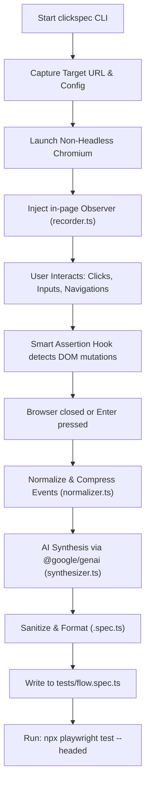

# clickspec ⚡

> **AI-Powered E2E Playwright Test Generator CLI**  
> Record live browser interactions and DOM mutations, and let AI synthesize resilient, clean, and production-grade Playwright specs (`.spec.ts`) with smart assertions.

[](https://nodejs.org/)
[](https://www.typescriptlang.org/)
[](https://playwright.dev/)
[](https://aistudio.google.com/)

---

## 🌟 Highlights

- **🎯 Zero Fragile Selectors**: Prioritizes user-facing accessibility locators (`page.getByRole()`, `page.getByLabel()`, `page.getByPlaceholder()`, `page.getByText()`). Forbids brittle CSS paths like `div > div:nth-child(3)`.
- **🧠 Smart Assertion Hooks**: Captures real-time DOM mutations following user actions (e.g. form submissions, button clicks) to assert visibility of toast alerts, headings, modals, and URL transitions.
- **⚡ Event Debouncing & Normalization**: Compresses rapid typing noise into single atomic `page.fill()` actions, deduplicating accidental double clicks and redundant navigations.
- **🤖 Dual AI Engine**: Native support for **Google Gemini API** (`@google/genai`) as primary with seamless fallback to **OpenAI** (`gpt-4o-mini`, etc.).
- **✨ Polished Terminal UX**: Interactive terminal prompts powered by `@clack/prompts` and `picocolors`.

---

## 🏗 Architecture

```
C:\Users\Admin\Documents\clickspec
├── package.json
├── tsconfig.json
├── .env.example
├── .gitignore
├── README.md
├── bin/
│   └── clickspec.js          # Executable CLI wrapper (#!/usr/bin/env node)
└── src/
    ├── index.ts              # Interactive terminal UX using @clack/prompts
    ├── config.ts             # Environment variable validation & defaults
    ├── types.ts              # Shared interfaces (RecordedEvent, TestSynthesisResult)
    ├── core/
    │   ├── browser.ts        # Browser launch, context, and page setup
    │   ├── recorder.ts       # Client-side event interceptor & DOM state capture
    │   └── normalizer.ts     # Event deduplication & context compression
    ├── ai/
    │   ├── client.ts         # AI client initializer (@google/genai)
    │   ├── prompt.ts         # System & user prompt templates for test generation
    │   └── synthesizer.ts    # Orchestrates raw events -> generated Playwright script
    └── utils/
        ├── logger.ts         # Formatted terminal UI helpers
        └── formatter.ts      # Code sanitation (strips markdown fences, verifies syntax)
```

### Pipeline Flow



---

## 🚀 Quick Start

### 1. Installation

```bash
git clone <repo-url> clickspec
cd clickspec
npm install
```

### 2. Configure Environment

Copy `.env.example` to `.env` and set your API key:

```bash
cp .env.example .env
```

Edit `.env`:
```env
# Gemini API Key (Recommended) - https://aistudio.google.com/
GEMINI_API_KEY=your_gemini_api_key_here

# Optional: Fallback to OpenAI
# OPENAI_API_KEY=your_openai_api_key_here
```

### 3. Build & Run

```bash
# Build TypeScript
npm run build

# Start interactive CLI
npm start

# Or in development mode with tsx
npm run dev
```

---

## 💻 CLI Usage

### Interactive Mode

Simply run `clickspec` without arguments to launch the guided prompt:

```bash
npm run dev
```

1. Enter target URL: (e.g. `http://localhost:3000` or `https://example.com`)
2. Specify output path: (defaults to `./tests/flow.spec.ts`)
3. A browser opens. Click, type, and navigate through your workflow.
4. When finished, **close the browser window** or **press Enter** in the terminal.
5. `clickspec` synthesizes your clean Playwright test file.

### CLI Flags & Arguments

```bash
clickspec [url] [options]
```

| Option | Shorthand | Description | Default |
|--------|-----------|-------------|---------|
| `url` | - | Target URL to record | Interactive prompt |
| `--output <path>` | `-o` | Output file path for generated spec | `./tests/flow.spec.ts` |
| `--model <name>` | `-m` | AI model override | `gemini-3.8-flash` |
| `--title <title>` | - | Custom test title | Dynamic based on URL |
| `--headless` | - | Run browser in headless mode | `false` |
| `--debug` | - | Print verbose debug logs | `false` |
| `--help` | `-h` | Show help information | - |

#### Examples:

```bash
# Record directly against a local dev server
npm run dev -- http://localhost:3000 -o ./tests/login.spec.ts

# Specify custom model and test title
npm run dev -- https://my-app.com --title "User Checkout Flow" -m gemini-3.8-flash
```

---

## 🧪 Running the Generated Playwright Spec

After generating the test, execute it directly with Playwright:

```bash
# Run headed to watch execution
npx playwright test ./tests/flow.spec.ts --headed

# View the Playwright HTML report
npx playwright show-report
```

---

## 🛡 License

MIT

